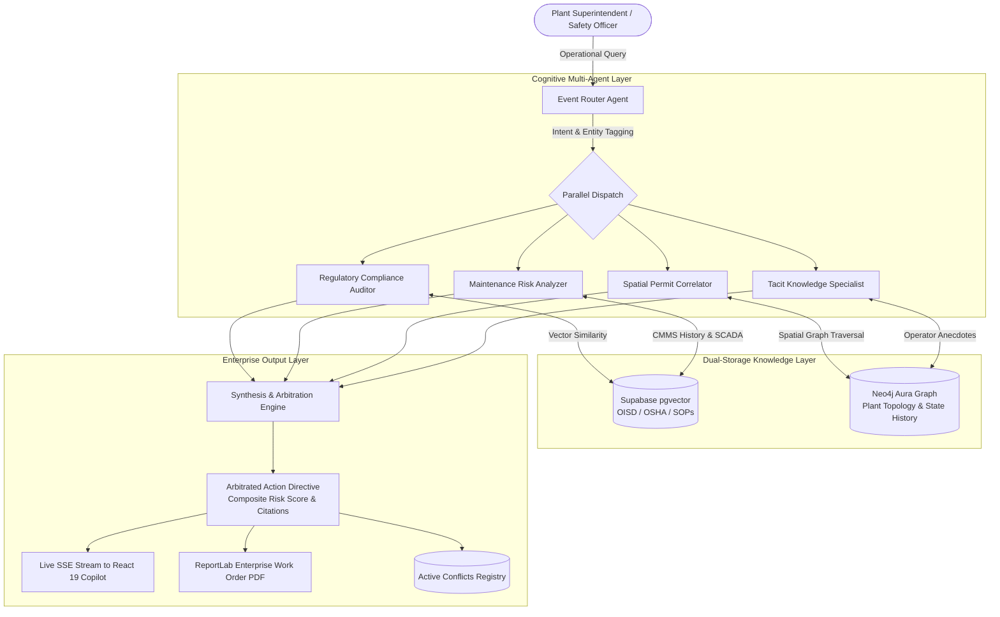

<div align="center">

# 🏭 PRAGYA AI
### **Autonomous Industrial Knowledge Reasoning & Operational Conflict Arbitration Engine**

[](https://github.com/prakhar-developer)
[](https://www.linkedin.com/in/prakhar--developer/)
[](https://prakhar-developer.web.app/)
[](https://www.python.org/)
[](https://fastapi.tiangolo.com/)
[](https://react.dev/)
[](https://langchain-ai.github.io/langgraph/)
[](https://neo4j.com/)
[](https://www.docker.com/)

<p align="center">
  <b>Designed and Engineered by <a href="https://github.com/prakhar-developer">Prakhar Srivastava</a></b>
</p>

*An industrial-grade, multi-agent reasoning engine that arbitrates operational conflicts across statutory safety regulations (OISD / OSHA), real-time maintenance logs, SCADA sensor telemetry, and active permit-to-work (PTW) records.*

</div>

---

## 📌 Executive Summary

Modern industrial facilities — such as oil refineries, petrochemical complexes, offshore drilling platforms, and thermal power plants — operate under unforgiving safety margins. In these environments, **knowledge that is safe in isolation can be fatal in combination**.

**PRAGYA AI** is an enterprise knowledge reasoning engine architected by **Prakhar Srivastava**. Unlike conventional document retrieval systems (standard RAG) that merely fetch isolated text snippets, PRAGYA AI models plant physical topology, equipment dependencies, and temporal workflows in an interactive knowledge graph. It deploys a network of parallel domain agents (Auditors, Risk Analyzers, Spatial Correlators) managed by an arbitration engine to proactively detect hidden hazards, quantify monetary risk exposure in Indian Rupees (₹), and generate actionable mitigation directives before work orders are executed.

---

## 🚨 The Problem Statement

### 1. The Catastrophic Reality of Operational Silos
Industrial disasters — from **Piper Alpha (1988)** to **BP Texas City (2005)** and recent refinery flash fires — rarely occur due to a lack of engineering documentation. They happen because critical operational data is fragmented across **isolated, disconnected software silos**:

```
┌─────────────────────────────────┐       ┌─────────────────────────────────┐
│     Permit-to-Work (PTW)        │       │   Computerized Maintenance      │
│     Safety System               │       │   Management System (CMMS)      │
│                                 │       │                                 │
│  "Active 48-hr Hot Work         │       │  "Mechanical Overhaul &         │
│   Welding on Line-4"            │       │   Depressurization on Pump-7A"  │
└────────────────┬────────────────┘       └────────────────┬────────────────┘
                 │                                         │
                 ▼                                         ▼
         ┌─────────────────────────────────────────────────────────┐
         │                  HUMAN BLIND SPOT                       │
         │  Nobody cross-references both tasks simultaneously      │
         │  against OISD-GDN-105 Clause 4.1 safety standards       │
         └─────────────────────────┬───────────────────────────────┘
                                   │
                                   ▼
                   🔥 CATASTROPHIC EXPLOSION RISK
```

### 2. Industry Metrics & Pain Points
Research across global energy and heavy manufacturing sectors reveals alarming vulnerabilities:

- **35% of Plant Engineer Working Hours** are squandered manually hunting down information across disparate legacy portals (*McKinsey Global Energy Survey*).
- **7 to 12 Disconnected Software Systems** operate simultaneously inside a typical refinery (PTW portals, SAP PM/Maximo CMMS, SCADA historians, PDF binders, vendor manuals).
- **18–22% of Unscheduled Plant Downtime** is caused by incomplete equipment history and concurrent conflicting maintenance activities (*BIS Research*).
- **₹ Crores in Financial Exposure:** A single hour of unexpected crude distillation or catalytic cracker shutdown costs between **₹50 Lakhs to ₹2.5 Crores** in lost production and penalty costs.
- **Tribal / Tacit Knowledge Loss:** With over 25% of senior plant superintendents retiring within the next decade, decades of undocumented plant-specific operational intuition are permanently lost.

### 3. Why Conventional AI & Traditional RAG Fails
When a safety superintendent asks:
> *"Can we perform hot-work welding on Line-4 this Saturday while Pump-7A is scheduled for mechanical overhaul?"*

- **Standard Semantic RAG:** Searches for keywords like `"welding"`. It returns generic OISD hot-work guidelines. It has **zero awareness** of active permits in the area, **zero understanding** that Pump-7A connects directly to Line-4, and **no capability** to reason across temporal schedules.
- **The Core Deficiency:** Conventional search cannot synthesize an answer when **the answer does not exist in any single document**, but only at the intersection of regulatory standards, live permits, and spatial plant piping diagrams.

---

## 💡 The Solution: PRAGYA AI

PRAGYA AI replaces passive document search with **Autonomous Multi-Agent Operational Reasoning**:



### Core Architectural Innovations:

1. **Temporal Entity State Graph (Neo4j):**
   - Industrial components (`Pump-7A`, `Line-4`, `PSV-220`, `V-410`) are modeled with dynamic `state_history` arrays rather than static properties.
   - The engine queries past degradation trends and future planned maintenance windows to detect co-location hazards across time.

2. **Multi-Agent Conflict Arbitration (LangGraph):**
   - Independent specialist agents evaluate queries from distinct domain lenses (regulatory mandate vs. maintenance backlog vs. permit co-location).
   - An arbitration engine resolves contradictory objectives, assigns a composite risk severity (0.0 to 1.0), and enforces statutory safety precedence (safety rules always supersede maintenance convenience).

3. **Monetary Risk Exposure in Indian Rupees (₹):**
   - Automatically translates operational hazards into quantifiable plant financial risk (e.g., *₹45.00 Lakhs downtime exposure due to thermal stress and line co-location*), giving plant directors immediate commercial clarity.

4. **Audit-Ready Work Order Generation:**
   - Automatically compiles verified safety findings into high-contrast, regulatory-compliant Work Order directives with mitigation checklists, technician instructions, and supervisor sign-off blocks.

5. **Tacit Knowledge Capture:**
   - Provides a structured intake mechanism for senior operators to record experiential heuristics (*"Pump-7A seal leaks whenever upstream reboiler temperature exceeds 280°C"*), transforming informal insights into queryable graph entities.

6. **Dual-Mode Resilient Architecture:**
   - **Production Mode:** Connects to Groq Cloud (LLaMA-3.3-70B), Neo4j Aura Graph, and Supabase pgvector.
   - **Resilient Fallback Mode:** Operates zero-config with local in-memory plant models and deterministic industrial reasoning if cloud credentials are not supplied.

---

## 🛠️ Technology Stack

| Layer | Technology | Purpose |
| :--- | :--- | :--- |
| **Architect & Lead** | **Prakhar Srivastava** | System architecture, multi-agent design, graph modeling, full-stack implementation |
| **Frontend Framework** | **React 19, TypeScript, Vite** | Enterprise operator console, ultra-responsive modern UI |
| **Styling & Motion** | **Tailwind CSS, Framer Motion** | High-contrast industrial design, fluid animations |
| **Graph Visualization** | **D3.js (Force-Directed Graph)** | Interactive plant topology canvas with node filtering & inspection |
| **Backend API** | **FastAPI (Asynchronous Python)** | High-throughput async REST & Server-Sent Events (SSE) streaming |
| **Agent Orchestration** | **LangGraph (`StateGraph`)** | Directed cyclic multi-agent graph with parallel execution branches |
| **Reasoning Engine** | **Groq Cloud (LLaMA-3.3-70B Versatile)** | Ultra-fast sub-second industrial LLM inference |
| **Knowledge Graph** | **Neo4j Aura & Cypher** | Physical asset hierarchy, piping connectivity, and temporal state history |
| **Vector Database** | **Supabase (PostgreSQL + pgvector)** | HNSW index for OISD safety codes, SOPs, and equipment manuals |
| **Embeddings** | **sentence-transformers (`all-MiniLM-L6-v2`)** | 384-dimensional dense semantic representations |
| **Document Parsing** | **PyMuPDF, openpyxl, python-docx** | Multi-format ingestion (PDF, Excel, Word, TXT, CSV, Logs) |
| **Report Generation** | **ReportLab** | High-contrast industrial Work Order Directive PDF generator |
| **Deployment** | **Docker, Railway, Nixpacks** | Single-container unified fullstack deployment |

---

## 🤖 The Multi-Agent Cognitive Team

| Agent | Responsibility | Analytical Focus |
| :--- | :--- | :--- |
| **EventRouter** | Query Classification & Dispatch | Computes cosine similarity across 5 operational intent prototypes to route requests dynamically. |
| **Compliance Auditor** | Regulatory Verification | Validates tasks against OISD standards (OISD-STD-118, OISD-GDN-105, OISD-STD-132) and OSHA regulations. |
| **Maintenance Risk Analyzer** | Equipment Health & Reliability | Analyzes MTBF, vibration logs, thermal excursions, and calculates ₹ financial risk exposure. |
| **Spatial Permit Correlator** | Co-Location & PTW Validation | Traverses Neo4j graph to detect spatial interference between hot-work, confined space, and mechanical permits. |
| **Tacit Knowledge Specialist** | Experiential Heuristics | Integrates operator heuristics and tribal insights into the reasoning loop. |
| **Synthesis & Arbitration** | Conflict Adjudication | Resolves cross-agent contradictions, calculates composite safety scores, and produces one actionable directive. |

---

## 💻 System Modules & Features

- **📊 Industrial Telemetry Dashboard (`/dashboard`):** Real-time monitoring of active plant documents, critical hazards, connected topology nodes, and total ₹ downtime exposure.
- **⚡ Conflict Resolution Manager (`/conflicts`):** Tabular and card-based registry of detected spatial and temporal clashes, with one-click PDF work order generation.
- **💬 Operational Reasoning Copilot (`/copilot`):** Live streaming conversational interface showing step-by-step agent execution, citations, and confidence scores.
- **🕸️ Plant Topology Graph Explorer (`/graph`):** Interactive D3 canvas showing physical equipment interconnections (`CONNECTED_TO`, `PROTECTED_BY`, `HAS_PERMIT`).
- **📑 Multi-Format Document Ingestion (`/documents`):** Ingests PDFs, spreadsheets, equipment manuals, and event logs with automatic entity extraction.
- **🧠 Expert Knowledge Capture (`/expert`):** Preserves veteran operator knowledge with automated graph translation.
- **🎯 Benchmark & Evaluation Suite (`/benchmarks`):** 10 standardized OISD refinery scenarios with ground truth comparison and sub-100ms latency validation.

---

## 🚀 Quick Start Guide

### Prerequisites
- Python 3.11+
- Node.js 20+ & npm

### 1. Clone & Setup Repository
```bash
git clone https://github.com/prakhar-developer/PRAGYA-AI.git
cd PRAGYA-AI
```

### 2. Backend Setup
```bash
# From workspace root
python -m venv venv
# On Windows:
.\venv\Scripts\activate
# On Linux/macOS:
source venv/bin/activate

# Install dependencies
pip install -r backend/requirements.txt

# Start backend server
python -m uvicorn backend.main:app --host 127.0.0.1 --port 8000
```
> **Instant Demo Ready:** If no `.env` credentials are provided, PRAGYA AI automatically initializes in **Resilient Demo Mode** with complete in-memory plant topologies (`Pump-7A`, `Line-4`, `PSV-220`, `WO-891`, `PTW-2024-047`).

### 3. Frontend Setup
```bash
# In a separate terminal
cd frontend
npm install
npm run dev -- --host 127.0.0.1 --port 5173
```
Open **`http://127.0.0.1:5173/`** in your browser to access the full operator console.

---

## 🚢 Production Deployment (Railway & Docker)

PRAGYA AI is pre-configured for **1-Click Unified Container Deployment** on [Railway](https://railway.app):

```bash
# Multi-stage Docker build builds both React 19 Frontend & FastAPI Backend into 1 container
docker build -t pragya-ai .
docker run -p 8000:8000 pragya-ai
```

See [RAILWAY_DEPLOYMENT.md](file:///f:/PRAGYA-AI-main/PRAGYA-AI-main/RAILWAY_DEPLOYMENT.md) for full cloud deployment instructions.

---

## 👨‍💻 Author & Lead Engineer

<div align="center">

### **Prakhar Srivastava**
*Full-Stack AI Engineer & Systems Architect*

[](https://github.com/prakhar-developer)
[](https://www.linkedin.com/in/prakhar--developer/)
[](https://prakhar-developer.web.app/)
[](mailto:prakhar_developer@outlook.com)

</div>

---

## 📄 License
This project is licensed under the Apache 2.0 License - see the LICENSE file for details.
